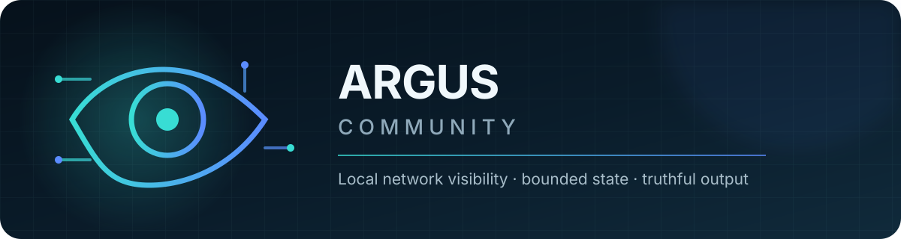
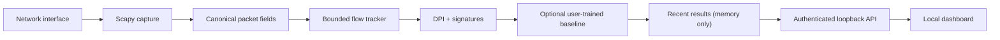

<p align="center">
  
</p>

<p align="center">
  <a href="https://github.com/blah-blah-cell/Ulti_Argus_Monorepo/actions/workflows/ci.yml"></a>
  
  
  <a href="LICENSE.md"></a>
</p>

<p align="center"><strong>See your network. Invent nothing.</strong></p>

Argus Community is a small, local-first network observation tool for Linux. It
captures real packets with Scapy, assembles bounded bidirectional flows, extracts
protocol metadata, applies deterministic signatures, optionally runs a baseline
you train on your own labels, and presents results in an authenticated dashboard.

> [!IMPORTANT]
> Argus Community is an observation tool, not a complete intrusion-prevention
> system. A flow without signature evidence or a configured model threshold
> match is `UNASSESSED`—never automatically labelled safe.

## Why Argus?

| Principle | What it means here |
| --- | --- |
| **Truthful output** | No generated traffic, random detector, placeholder score, or fake success response. |
| **Local by default** | API and dashboard bind to loopback; capture data stays in memory. |
| **Bounded state** | Active flows, payload prefixes, and completed results all have explicit limits. |
| **Reviewable core** | One Python capture path, one REST API, one static dashboard—no hidden service mesh. |

## What ships

- Real IPv4/IPv6 packet capture through Scapy/libpcap
- TCP, UDP, and ICMP flow aggregation with idle and TCP-close finalization
- Bounded payload-prefix retention for protocol inspection
- HTTP, TLS, DNS, SSH, SMB, RDP, and common-port identification
- Deterministic payload and flow signature evidence
- A compact NumPy logistic baseline with a versioned, validated JSON artifact
- Authenticated FastAPI endpoints and a responsive vanilla HTML dashboard
- Explicit `UNASSESSED` and `SUSPICIOUS` states

## Capability boundary

| Included | Not included |
| --- | --- |
| Packet and flow observation | Trained detector weights |
| Deterministic signatures | Training datasets or research models |
| Train-your-own logistic baseline | Automatic model generation |
| In-memory recent-flow view | Packet-capture archives |
| Manual capture start/stop | Firewall or host enforcement |
| Local authenticated API | Claims that an unmatched flow is benign |

No pretrained artifacts, datasets, advanced research implementations, evaluation
claims, or automatic enforcement policies are distributed in this repository.

> [!NOTE]
> Need a ready-to-run baseline? Open a GitHub issue. Pretrained baseline weights
> will be made available on community request as a separate, versioned download
> with provenance, dataset and license details, and evaluation notes. They will
> remain outside the source repository.

## Architecture



See [docs/ARCHITECTURE.md](docs/ARCHITECTURE.md) for limits, lifecycle, and
decision semantics.

## Quick start

Tested with Ubuntu 22.04/24.04 and Python 3.11+.

```bash
sudo apt update
sudo apt install -y python3 python3-venv python3-dev libpcap-dev

git clone https://github.com/blah-blah-cell/Ulti_Argus_Monorepo.git
cd Ulti_Argus_Monorepo

python3 -m venv .venv
source .venv/bin/activate
python -m pip install --upgrade pip
python -m pip install -e ./Ulti_argus

cp .env.example .env
python -c "import secrets; print(secrets.token_urlsafe(32))"
```

Paste the generated value after `ARGUS_API_KEY=` in `.env`, then run:

```bash
./start.sh
```

| Service | Local URL |
| --- | --- |
| Dashboard | <http://127.0.0.1:3000> |
| API | <http://127.0.0.1:8000> |
| OpenAPI | <http://127.0.0.1:8000/docs> |

The launcher uses your existing environment and never installs packages or
creates substitute models. Packet capture needs suitable Linux capabilities or
root privileges; keep the API bound to loopback if running with elevated rights.

## Train the baseline

Argus ships the algorithm and feature contract, not weights. Export real flow
observations, label them from ground truth, and create a local JSON artifact:

```bash
curl -H "X-API-Key: $ARGUS_API_KEY" \
  "http://127.0.0.1:8000/api/detect/flows?limit=500" > flows.json

python -m argus_v.baseline prepare --input flows.json --output labelled-flows.csv
# Fill the label column with 0/1 or benign/malicious.
python -m argus_v.baseline train \
  --csv labelled-flows.csv \
  --output "$HOME/.local/share/argus/baseline.argus-baseline.json"
```

Set `ARGUS_BASELINE_MODEL` in `.env` to that absolute path and restart Argus.
See [docs/TRAIN_BASELINE.md](docs/TRAIN_BASELINE.md) for the feature schema,
labelling rules, validation cautions, and runtime behavior.

## Result semantics

- `UNASSESSED`: no signature or configured model crossed its decision threshold.
- `SUSPICIOUS`: signature evidence exists or the user-trained baseline crossed its threshold.
- Missing or failed capture backends return an error instead of simulated traffic.

Every result separates observed fields, signature evidence, health, and decision
provenance. Scores from absent models are not represented as zero.

## API surface

| Method | Endpoint | Purpose |
| --- | --- | --- |
| `POST` | `/api/auth/verify` | Exchange the launcher token for a local session cookie |
| `GET` | `/api/system` | Runtime, host, and capture health |
| `GET` | `/api/system/interfaces` | Capture-capable interfaces |
| `POST` | `/api/system/capture` | Start or stop real capture |
| `GET` | `/api/detect/flows` | Recent completed flow observations |
| `GET` | `/api/detect/flows/{id}` | Detailed observed flow data |
| `GET` | `/api/detect/alerts` | Flows requiring operator review |
| `GET` | `/api/signatures/patterns` | Active deterministic patterns |

Traffic-detail routes require the local session cookie or `X-API-Key`.

## Data handling

- No PCAP file is created by the supported runtime.
- Completed results are held in process memory and disappear on restart.
- Only bounded payload prefixes are retained while a flow is active.
- `.env`, captures, datasets, model formats, private keys, and generated output are ignored by Git.

Only monitor networks you own or are explicitly authorized to inspect.

## Project map

```text
Ulti_argus/src/argus_v/
├── baseline.py   # train/load the optional logistic baseline
├── dpi/          # protocol metadata and deterministic patterns
├── oracle_core/  # privacy-aware logging, validation, anonymization
└── retina/       # capture and flow aggregation primitives

web/
├── api/          # authenticated FastAPI runtime
└── public/       # dependency-free local dashboard
```

## Development

```bash
source .venv/bin/activate
python -m pip install -e "./Ulti_argus[dev]"
ruff check --config Ulti_argus/pyproject.toml --select E,F,I,B --ignore E501,B008 web/api Ulti_argus/src/argus_v Ulti_argus/tests
pytest -q Ulti_argus/tests
python -m build Ulti_argus
```

Read [CONTRIBUTING.md](CONTRIBUTING.md) before opening a pull request. Security
issues should follow [SECURITY.md](SECURITY.md).

## License

[MIT](LICENSE.md) © 2026 Argus Community contributors.
